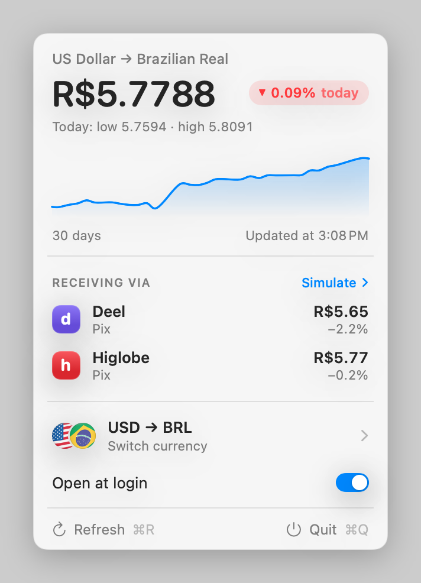
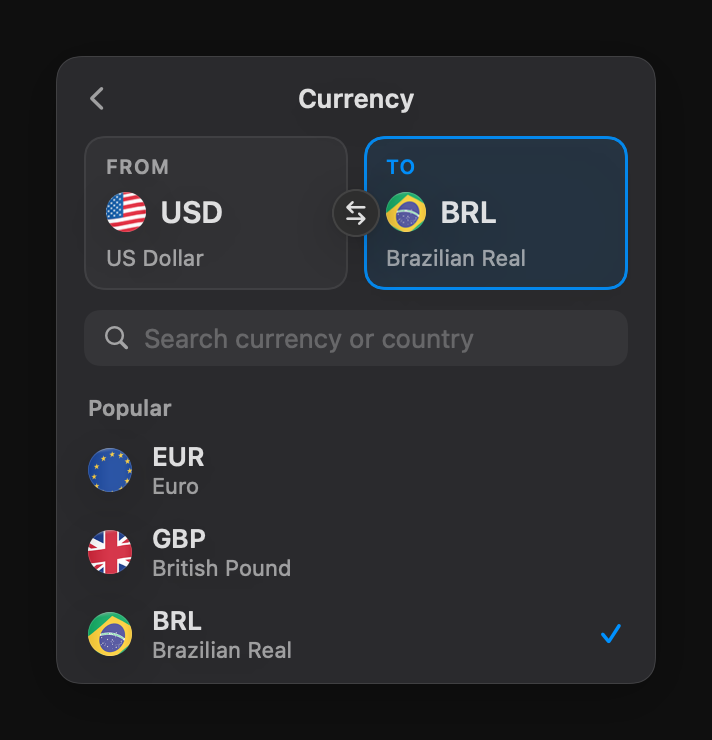

<p align="center">
  
</p>

<h1 align="center">Cambio</h1>

<p align="center">
  The exchange rate in your Mac's menu bar. Clean, free, open source.<br>
  <a href="README.pt-BR.md">Leia em português</a>
</p>

<p align="center">
  
  
</p>

## Why

I work for companies abroad and get paid in US dollars, so I check the exchange rate every
day. The menu bar apps I found were either complex, paid, or both. I wanted one number at
the top of the screen, always up to date, and nothing else. So I built it.

## Features

- **The rate in the menu bar**, e.g. `USD 5,78 ▾`, with the day's direction.
- **A small panel** with the full price, today's change, low and high, and a 30-day chart.
- **Any pair the data source offers** (over 500): pick FROM and TO, with flags and search.
  Includes Brazil's tourism rate (BRLT) and PTAX (BRLPTAX).
- **Always fresh**: updates every minute, right after your Mac wakes up, and when you open the panel.
- **Works offline**: keeps the last rate and tells you it is offline.
- **Open at login**, light and dark mode, English and Portuguese.
- **Lightweight**: no Dock icon, no dependencies, a few MB.

## Install

1. Download `Cambio-x.y.z.zip` from the [latest release](../../releases/latest).
2. Unzip it and drag **Cambio** to **Applications**.
3. Open it. The first time, macOS says it cannot verify the developer: go to
   **System Settings → Privacy & Security**, scroll down and click **Open Anyway**.

   Or, in Terminal:

   ```bash
   xattr -dr com.apple.quarantine /Applications/Cambio.app
   ```

4. Optional: click the rate in the menu bar and turn on **Open at login**.

Why the warning? Removing it requires Apple's paid developer program for notarization.
Cambio is signed ad-hoc instead, and its full source is right here.

Requires macOS 14 Sonoma or later. Runs natively on Apple Silicon and Intel.

## Build from source

You need macOS 14+ and Xcode 16+ (Swift 6).

```bash
git clone <this repository's URL> cambio
cd cambio
make install
```

| Command | What it does |
|---|---|
| `make test` | Runs the test suite |
| `make run` | Builds `build/Cambio.app` and opens it |
| `make install` | Builds and installs to `/Applications` |
| `make zip` | Builds the release zip |
| `make screenshots` | Renders the README screenshots with live data |

You can also open `Package.swift` in Xcode.

## How it works

Rates come from [AwesomeAPI](https://docs.awesomeapi.com.br/api-de-moedas), which is free
and needs no key. Its public responses are cached for a few minutes, so the number in the
bar can be up to a few minutes old. That is plenty for keeping an eye on the rate, but it
is not a trading feed.

The code is split in two:

- `Sources/CambioCore`: models, API, formatting and state. Fully tested.
- `Sources/Cambio`: the SwiftUI menu bar app.

The design notes live in [`docs/design.md`](docs/design.md).

## Contributing

Issues and pull requests are welcome. Before opening a PR:

1. Run `make test`. Logic lives in `CambioCore` and every behavior there has a test.
2. For UI changes, run `make screenshots` and look at both languages, light and dark.
3. Keep it small: Cambio is meant to stay one number in the menu bar.

## Privacy

Cambio talks only to `economia.awesomeapi.com.br`. No account, no analytics, no tracking.
Your chosen pair and the last rate are stored locally on your Mac.

## License

[MIT](LICENSE). Exchange rate data by AwesomeAPI.
