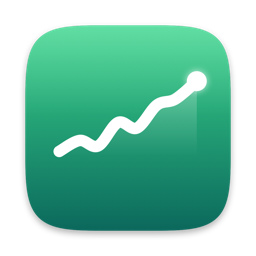
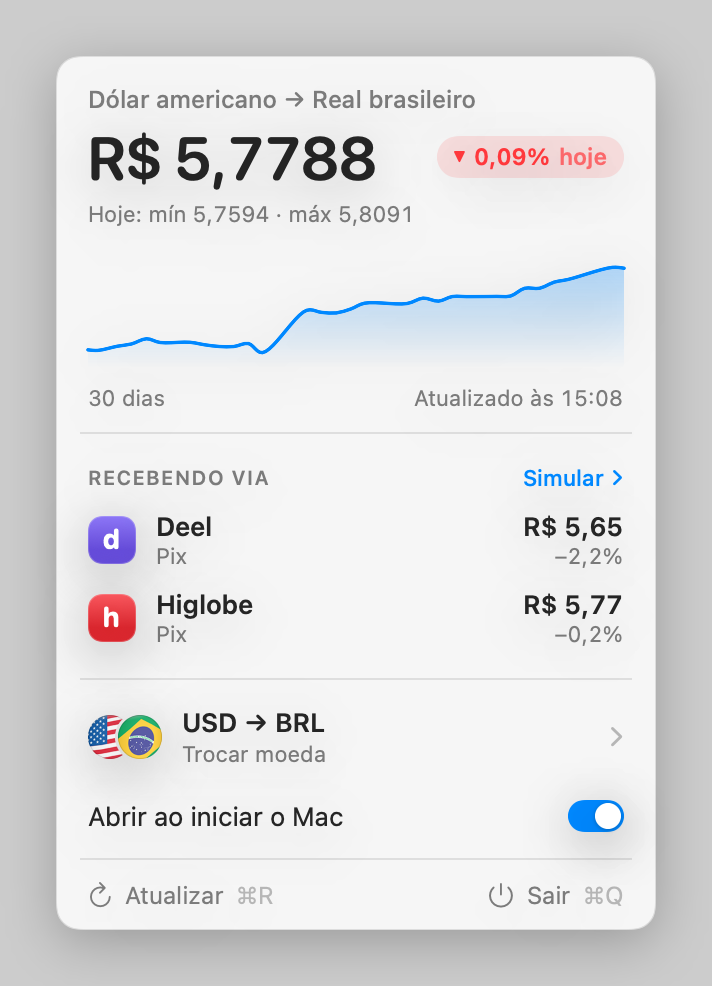
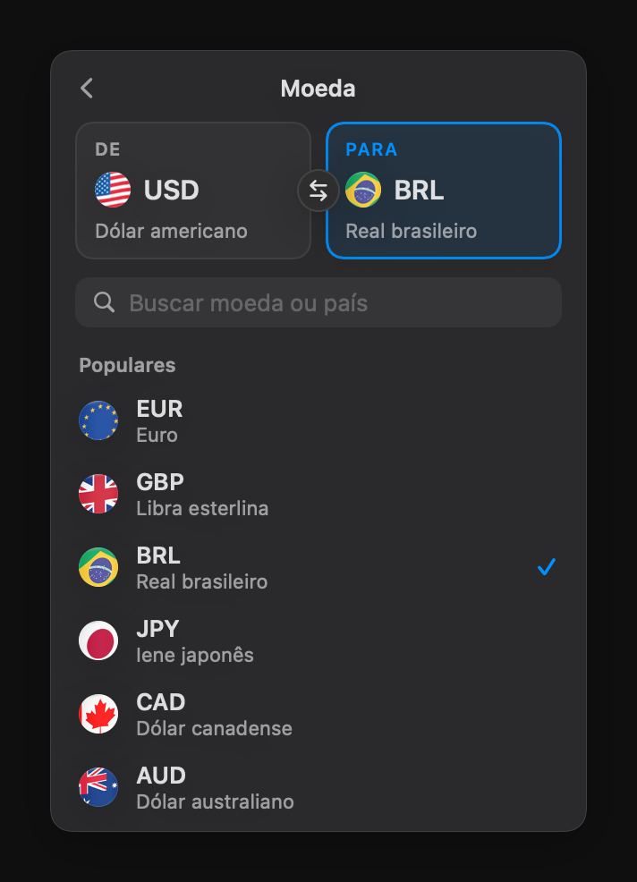
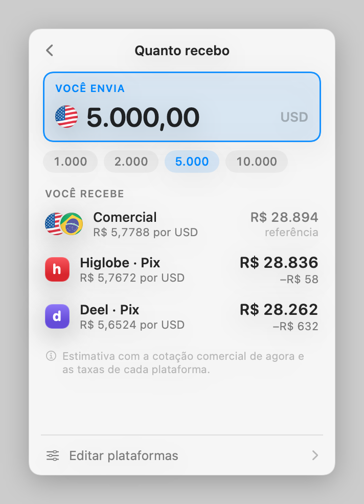
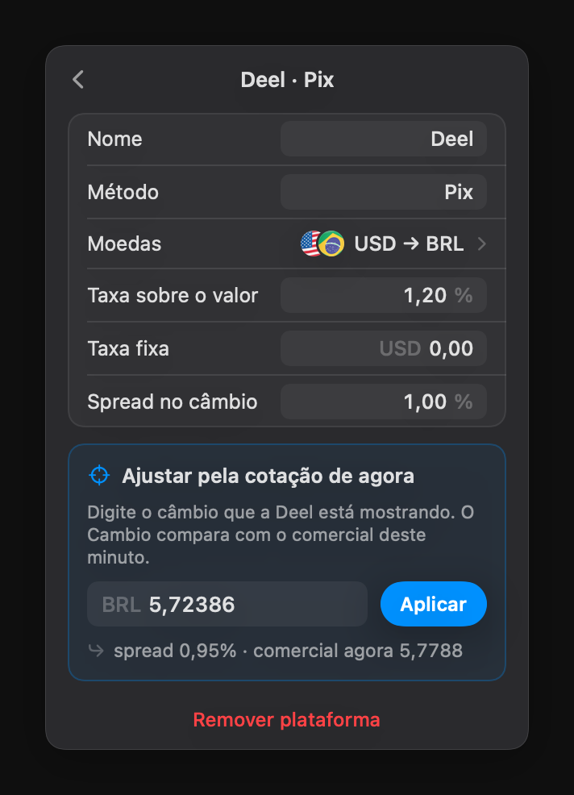

<p align="center">
  
</p>

<h1 align="center">Cambio</h1>

<p align="center">
  A cotação na barra de menu do seu Mac. Limpo, gratuito e open source.<br>
  <a href="README.md">Read in English</a>
</p>

<p align="center">
  
  
</p>

## Por quê

Trabalho para empresas de fora, recebo em dólar e acompanho o câmbio todo dia. Os apps de
barra de menu que encontrei eram complexos, pagos, ou as duas coisas. Eu queria só um número
no topo da tela, sempre atualizado, e mais nada. Então fiz.

## Funcionalidades

- **A cotação na barra de menu**, por exemplo `USD 5,78 ▾`, com a direção do dia.
- **Um painel pequeno** com o preço completo, a variação do dia, a mínima e a máxima, e um
  gráfico de 30 dias.
- **Qualquer par que a fonte de dados oferece** (mais de 500): escolha DE e PARA, com
  bandeiras e busca. Inclui o dólar turismo (BRLT) e a PTAX (BRLPTAX).
- **Sempre atualizado**: a cada minuto, logo que o Mac acorda e quando você abre o painel.
- **Quanto vou receber?** Cadastre as plataformas pelas quais você recebe (Deel, Higlobe ou
  a sua) e veja o câmbio real de cada uma ao lado do comercial, e quanto cai na sua conta
  para qualquer valor.
- **Funciona sem internet**: mantém a última cotação e avisa que está sem conexão.
- **Abrir ao iniciar o Mac**, modo claro e escuro, português e inglês.
- **Leve**: sem ícone no Dock, sem dependências, poucos MB.

## Quanto vou receber?

As plataformas de pagamento não convertem pela cotação do jornal. Cada uma cobra uma taxa
e converte um pouco abaixo da comercial, e a diferença pesa.

<p align="center">
  
  
</p>

O Cambio estima quanto cai na sua conta com:

```
recebe = (valor × (1 − taxa%) − taxa fixa) × cotação comercial × (1 − spread%)
```

- **Modelos** medidos em novembro de 2026 com saques reais:
  - **Deel · Pix**: taxa de 1,2% e câmbio cerca de 1,0% abaixo do comercial.
  - **Higlobe · Pix**: sem taxa e câmbio 0,2% abaixo do comercial.
- **Plataformas personalizadas**: você define nome, moedas, taxas e spread.
- **Ajuste pela cotação de agora**: digite o câmbio que a sua plataforma está mostrando.
  O Cambio compara com o comercial do mesmo minuto e calcula o spread da sua conta.

São estimativas. As plataformas mudam as taxas, e algumas só atualizam o câmbio de tempos
em tempos, então confira na plataforma antes de mover o dinheiro.

## Instalação

1. Baixe o `Cambio-x.y.z.zip` no [release mais recente](../../releases/latest).
2. Descompacte e arraste o **Cambio** para **Aplicativos**.
3. Abra. Na primeira vez, o macOS diz que não consegue verificar o desenvolvedor: vá em
   **Ajustes do Sistema → Privacidade e Segurança**, role até o fim e clique em
   **Abrir Mesmo Assim**.

   Ou, no Terminal:

   ```bash
   xattr -dr com.apple.quarantine /Applications/Cambio.app
   ```

4. Opcional: clique na cotação na barra de menu e ligue **Abrir ao iniciar o Mac**.

Por que o aviso? Tirá-lo exige notarizar o app pelo programa pago de desenvolvedores da
Apple. O Cambio é assinado de forma ad-hoc, e o código-fonte completo está aqui.

Requer macOS 14 Sonoma ou superior. Roda nativo em Apple Silicon e Intel.

## Compilar a partir do código

Você precisa de macOS 14+ e Xcode 16+ (Swift 6).

```bash
git clone https://github.com/joaoderoldo/cambio.git
cd cambio
make install
```

| Comando | O que faz |
|---|---|
| `make test` | Roda os testes |
| `make run` | Gera o `build/Cambio.app` e abre |
| `make install` | Gera e instala em `/Applications` |
| `make zip` | Gera o zip do release |
| `make screenshots` | Gera as imagens do README com dados ao vivo |

Também dá para abrir o `Package.swift` no Xcode.

## Como funciona

As cotações vêm da [AwesomeAPI](https://docs.awesomeapi.com.br/api-de-moedas), que é
gratuita e não pede chave. As respostas públicas ficam em cache por alguns minutos, então o
número na barra pode ter alguns minutos de atraso. É o bastante para acompanhar o câmbio,
mas não é um feed para operar no mercado.

O código é dividido em duas partes:

- `Sources/CambioCore`: modelos, API, formatação e estado. Tudo testado.
- `Sources/Cambio`: o app SwiftUI de barra de menu.

As notas de design estão em [`docs/design.md`](docs/design.md).

## Contribuir

Issues e pull requests são bem-vindos. Antes de abrir um PR:

1. Rode `make test`. A lógica fica no `CambioCore`, e todo comportamento ali tem teste.
2. Para mudanças de interface, rode `make screenshots` e confira os dois idiomas, claro e escuro.
3. Mantenha simples: a ideia do Cambio é continuar sendo um número na barra de menu.

## Privacidade

O Cambio só conversa com `economia.awesomeapi.com.br`. Sem conta, sem analytics, sem
rastreamento. O par escolhido e a última cotação ficam salvos localmente no seu Mac.

## Licença

[MIT](LICENSE). Dados de câmbio da AwesomeAPI.
